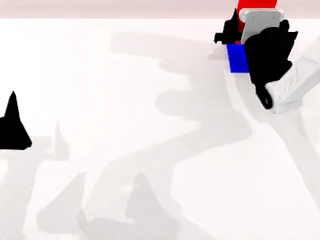

# π₀.₅ → ARX-X5 跨本体迁移与微调

**RoboTwin handover_block 最终实测：10/10 自主抓起、8/10 右手独立交接、7/10（70%）官方完整任务成功。**

最佳节点为 **新150-clean、纯 Flow Matching、EMA step-2000、H50/K15**。使用实时ARX三路图像与状态，从每个seed原始初态自主执行抓取、交接和放置；稳定净抬升161.08–212.80mm。结果来自目标本体示范微调后的π₀.₅，冻结Aloha→ARX映射实验单独记录。

[最终七阶段实验报告](docs/final_20261126/final_experiment_report.md) · [完整逐场对照](research/final_20261126/comparison.md) · [机器可读结果](research/final_20261126/comparison.json) · [展示录像](media/final-arx/README.md) · [证据索引](docs/final_20261126/evidence_index.md)

## 同口径原生评测

全部为600行动作上限、原生`env.take_action(..., action_type="qpos")`及`env.check_success()`，保留重力补偿和PhysX接触，绕开G2自定义提前熔断；无专家接管、人工对准或夹爪覆盖。

|模型|K|seed|抓起|右手独立交接|官方完整成功|
|---|---:|---|---:|---:|---:|
|混合ARX/Aloha LoRA step0600|15|0–4|5/5|0/5|0/5|
|旧190-clean辅助损失 step2500|4|0–4|5/5|4/5|0/5|
|同一旧step2500|25|0–4|4/5|1/5|1/5|
|同一旧step2500|15|0–4|3/5|3/5|2/5|
|**新150-clean纯Flow/EMA step2000**|**15**|**0–4**|**5/5**|**4/5**|**3/5**|
|同一新EMA补测|15|5–9|5/5|4/5|4/5|
|**最终合并**|**15**|**0–9**|**10/10**|**8/10**|**7/10**|

2000步达到预设3/5早停条件，未继续3000步。seed0–4属于历史开发摸底初态，扩测5–9结果与首五场分别保留。HDF5原Val/Test划分始终不变。新旧方案涉及多项共同改变，表中不把联合收益拆成某一项的独立因果效果。

## 代表录像

- [seed0：完整成功](media/final-arx/ema2000-k15-seed-0-success.mp4)
- [seed5：扩测完整成功](media/final-arx/ema2000-k15-seed-5-success.mp4)
- [seed9：扩测完整成功](media/final-arx/ema2000-k15-seed-9-success.mp4)
- [seed3：交接完成、放置偏出目标](media/final-arx/ema2000-k15-seed-3-failure.mp4)



完整录像按执行动作采帧、10fps展示，播放时长不等于物理时间。持物/交接指标由实际接触与物理tick统计，官方成功以原生谓词为准。剩余失败：seed3终点x偏差−35.712mm，超30mm轴向容差；seed4/6抓起后右手未独立接稳。

## 七阶段路线

1. 官方OpenPI+LIBERO复现：受限15场功能基线15/15，[原始验收](acceptance_report.md)。
2. 选定Aloha-AgileX/ARX-X5与共同handover_block任务。
3. 整理两本体图像、状态、动作、语言及轨迹划分；校验原生专家数据。
4. 建立ARX原生归一化/增量动作接口，独立研究冻结Aloha的FK/IK映射；修复初始化重力补偿遗漏。
5. 完成混合LoRA、clean/randomized探索、190-clean及150-clean纯Flow/EMA等训练对照。
6. 完成原生同口径5-seed及最佳节点10-seed闭环，最终官方7/10。
7. 归档统一指标、失败案例、代表视频和代码快照；详细配置与不利结果见最终报告。

最终训练仅用新采150条clean，Train重算q01/q99；完整视觉/动作专家微调+语言LoRA，80/20六阶段采样、轻状态扰动、有效batch16、EMA0.99。以原生Flow目标取代早期单步clean FK/夹爪辅助损失。CuRobo专家采集与模型评测分开，专家成功不计入模型成绩。

## 复核与目录

```bash
python scripts/verify_final_archive.py
```

该命令只在CPU读取本地JSON/CSV、文件哈希及视频元信息，不加载模型、不启动仿真或云实例。

- `docs/final_20261126/`：最终报告、证据索引、历史README。
- `research/final_20261126/`：脱敏原始结果摘要、十场receipt、数据seed映射、配置、norm_stats及历史审计。
- `experiments/final_clean150_ema/`：最终核心训练/推理/评测代码快照及依赖说明。
- `media/final-arx/`：三条成功/一条失败完整录像、终帧与SHA256清单。

大权重、H5、虚拟环境、平台会话和完整physics.jsonl留在个人研究存储，不提交Git。A800运行结束后已释放到0MiB，并核实Notebook已关机。本次归档不重新开机；GitHub推送需用户确认。

## 历史研究记录

保留[2026-11-06 README](docs/final_20261126/README_historical_20261106.md)、[官方功能复现](evaluation_report.md)、[冻结G2失败分析](docs/g2_failure_root_cause_report.md)与[原任务选型](robotwin_feasibility.md)。早期冻结/映射成绩与本轮微调成绩分别评价，原报告不覆盖。
