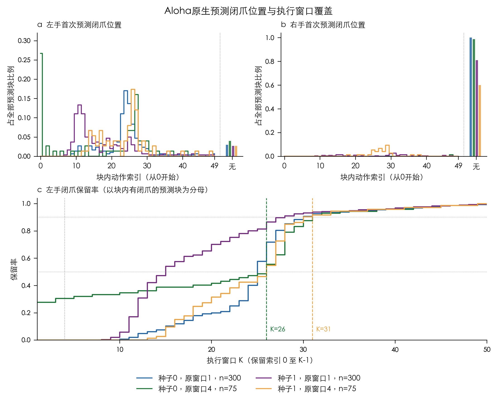

# G2-E：首次预测闭爪位置与窗口选择

结论：在原生 Aloha 的四条既有轨迹上，按每条轨迹至少覆盖 50% / 90% 的已预测左手闭爪，最小公共执行窗口分别为 **26 / 31**。新试验使用 1、4 作对照；没有选用任意的 8 或 16。

本次统计覆盖作业 127054052 的全部 840 个原始预测块：Aloha 750，ARX 90。每块形状 50×14，全部有限。原始 NPY 保持只读；完整原始数值在 SCNet 用原限位和最大 0.01 归一化裁剪量重新扫描了 K=1…50，750 个既有 Aloha plan 均逐元素复现。

“闭爪”定义为原始归一化夹爪目标首次 <0.5，索引从 0 开始。K 执行索引 0…K−1。整块没有闭爪独列为“无”，不混入后缀截断。图 a/b 的分母是该组全部预测块；图 c 与下表截断率的分母是该组有左手闭爪的块。

| 既有轨迹 | 块数 | 有左闭爪 / 无 | K1 截断 | K4 截断 | K26 截断 | K31 截断 |
|---|---:|---:|---:|---:|---:|---:|
| seed0-A-native-w1 | 300 | 291 / 9 | 291/291 (100.0%) | 291/291 (100.0%) | 82/291 (28.2%) | 21/291 (7.2%) |
| seed0-A-native-w4 | 75 | 72 / 3 | 52/72 (72.2%) | 50/72 (69.4%) | 32/72 (44.4%) | 6/72 (8.3%) |
| seed0-B-arx-w1 | 26 | 19 / 7 | 19/19 (100.0%) | 19/19 (100.0%) | 19/19 (100.0%) | 19/19 (100.0%) |
| seed0-B-arx-w4 | 7 | 4 / 3 | 4/4 (100.0%) | 4/4 (100.0%) | 4/4 (100.0%) | 4/4 (100.0%) |
| seed1-A-native-w1 | 300 | 292 / 8 | 292/292 (100.0%) | 292/292 (100.0%) | 39/292 (13.4%) | 18/292 (6.2%) |
| seed1-A-native-w4 | 75 | 73 / 2 | 73/73 (100.0%) | 73/73 (100.0%) | 33/73 (45.2%) | 6/73 (8.2%) |
| seed1-B-arx-w1 | 56 | 52 / 4 | 52/52 (100.0%) | 52/52 (100.0%) | 52/52 (100.0%) | 18/52 (34.6%) |
| seed1-B-arx-w4 | 1 | 0 / 1 | 无闭爪，未定义 | 无闭爪，未定义 | 无闭爪，未定义 | 无闭爪，未定义 |

Aloha 合并后，728/750 块预测过左闭爪；K1、K4 分别截断 708/728（97.25%）、706/728（96.98%）。K26、K31 分别截断 186/728（25.55%）、51/728（7.01%）。这是查询加权的描述值，原 K1 每条轨迹有 300 次查询、K4 只有 75 次；主分析保留四组，不把合并值当作均衡种子的效果估计。

选择规则先对四组分别求最小 K，再取最大值。K26 保证每组条件保留率 ≥50%，K31 ≥90%。选择依据是旧数据的探索性描述，随后锁定新试验；不能把旧数据上的覆盖率当作新闭环的成功率。

| 原生轨迹 | K26 数值合规 / 含闭爪 | K31 数值合规 / 含闭爪 |
|---|---:|---:|
| seed0-A-native-w1 | 299 / 208 | 299 / 269 |
| seed0-A-native-w4 | 75 / 40 | 75 / 66 |
| seed1-A-native-w1 | 297 / 250 | 297 / 271 |
| seed1-A-native-w4 | 73 / 40 | 73 / 66 |

K26、K31 各有 744/750 个前缀通过原数值限制；另外 6 个会被原检查拒绝。不得放宽阈值来取得全部合规。表中“含闭爪”仅统计通过数值检查的前缀；尚未包含 FCL、跟踪及真实接触门禁。

ARX 的 90 块完整分布见[补充图](../research/g2/g2e-20261106-r1/figures/arx-closure-distribution.png)，未用于原生窗口选择。右手没有预测闭爪的块也全部保留；不能把左手覆盖提升解释为已预测或已完成交接。

来源：[完整直方计数](../research/g2/g2e-20261106-r1/distribution/first-closure-counts.csv)、[选择规则与源哈希](../research/g2/g2e-20261106-r1/distribution/selection.json)、[全部 K 数值扫描](../research/g2/g2e-20261106-r1/prefix-sweep.json)。本分析没有独立同分布的 840 个重复实验，只有两个环境种子；不计算块级置信区间、显著性或效果承诺。
