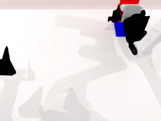
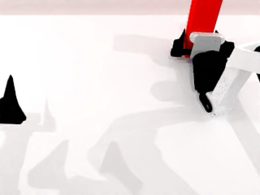

# 最终EMA2000/K15完整录像

|文件|seed|官方成功|帧数|用途|
|---|---:|---|---:|---|
|[seed0](ema2000-k15-seed-0-success.mp4)|0|True|289|首五场完整成功|
|[seed5](ema2000-k15-seed-5-success.mp4)|5|True|276|扩测成功|
|[seed9](ema2000-k15-seed-9-success.mp4)|9|True|288|扩测成功|
|[seed3](ema2000-k15-seed-3-failure.mp4)|3|False|601|已交接，终点x−35.712mm，放置偏出轴向容差|

全部从原始初态自主执行，原文件未剪辑、未重编码。每完成行动作一帧并含初始帧，320×240、10fps；原生TOPP动作耗时不固定，影片播放时间不代表真实仿真时间。稳定持物秒数来自物理日志。

通过SCNet文件管理下载，未启动A800/无卡实例。本地AVFoundation完整解码通过，帧数和字节数与远端评测元数据一致。逐文件SHA256及来源见[manifest.json](manifest.json)。`*-final.png`是本地从原录像末尾提取的展示帧；任务判定来自原receipt和check_success。

